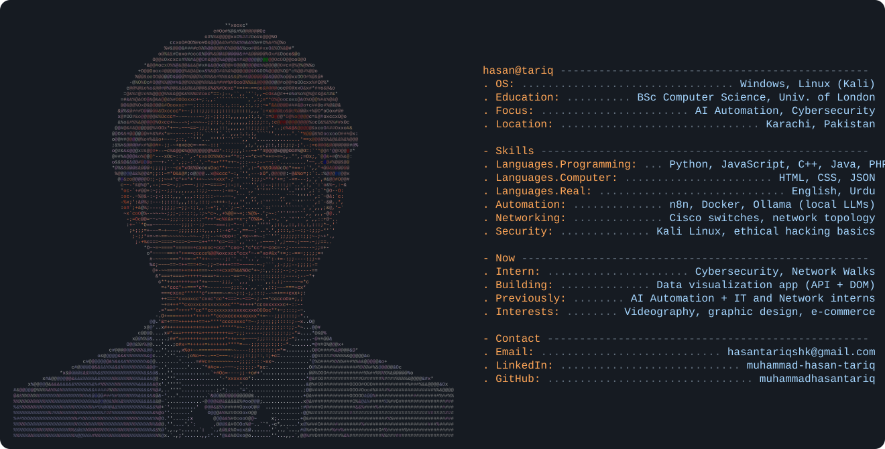

<!-- Replace "muhammadhasantariq" with your GitHub username (and the repo must have that same name) -->

  

  

## 👋 About me
I'm **Muhammad Hasan Tariq**, a Computer Science student (BSc, University of London) who likes building things across AI automation, IT and networking, front-end development and cybersecurity. I've interned in workflow automation, prompt engineering and network infrastructure, and I'm now learning ethical hacking.

## 🛠️ Tech stack

## 🚀 Featured projects
- **Internet History of Pakistan**: a solo-built website covering 2005 to 2026, from research and wireframes to front-end and JSON data integration.
- **Data Representation & Visualization App**: pulls live data from APIs and uses DOM manipulation to render pie charts, graphs and other visualizations.
- **2D Platformer Game**: a playable game built from scratch with character movement, jumping mechanics and level design.
- **Resilient n8n automations**: pipelines with webhooks, validation, branching, batching and error recovery, running on self-hosted local LLMs (Ollama).

## 💼 Experience
- Cybersecurity & Ethical Hacking Intern, Network Walks (Nov 2026 to present)
- AI Automation Intern, Developers Hub Corporation (Aug to Oct 2026)
- AI Intern, Devsphere (Aug to Oct 2026)
- IT & Network Intern, Mustaqim Dyeing & Printing (Jul 2026)

## 📊 GitHub stats

  
  

## 🌐 Connect
[Email](mailto:hasantariqshk@gmail.com) · [LinkedIn](https://linkedin.com/in/muhammad-hasan-tariq)
